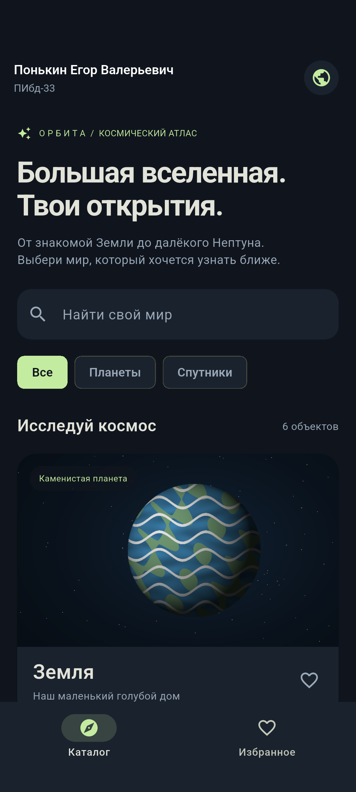
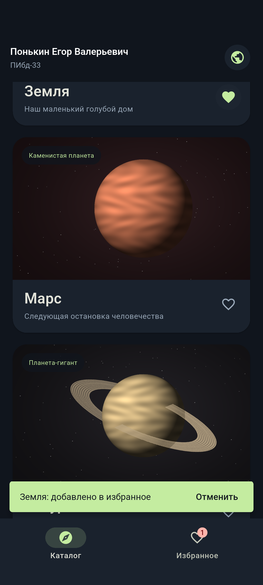
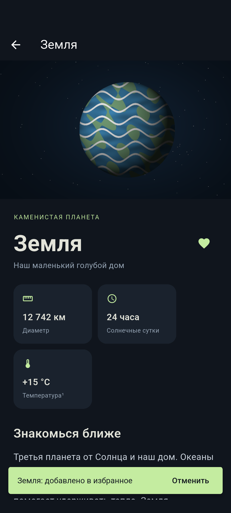

# Лабораторные работы 1–4. Мобильная разработка

**Студент:** Понькин Егор Валерьевич<br>
**Группа:** ПИбд-33<br>
**Проект:** «Орбита» — каталог небесных тел<br>
**Стек:** Flutter, Dart, Material 3<br>
**Платформа:** Android

## Лабораторная 1. Создание и запуск Flutter-проекта

Цель — подготовить инструменты разработки, создать Flutter-приложение и связать его с Git.

Установлены Flutter SDK, Android SDK и JDK. В VS Code установлены расширения Flutter и Dart. Проект создан командой:

```powershell
flutter create --platforms android,web --org ru.ponkin --project-name orbita_labs .
```

В `AppBar` главного экрана указаны полные ФИО студента и группа. Целевая платформа Android включена; приложение собирается в APK. Исходный код хранится в публичном репозитории:

[github.com/shadowwiu/orbita-mobile-labs](https://github.com/shadowwiu/orbita-mobile-labs)

## Лабораторная 2. Основы Dart

Цель — написать осмысленную программу, использующую заданные возможности языка.

Консольная программа `bin/lab2.dart` читает каталог небесных тел из JSON, выполняет поиск и выводит результат. Используются:

1. `SpaceObject` — класс с полями `name`, `type`, `diameterKm` и другими; методы `matches()` и `summary()`.
2. `SpaceObjectType` — enum для типов небесных тел.
3. `for` — цикл вывода найденных объектов.
4. `List<SpaceObject>` и `List<String>` — типизированные коллекции.
5. Анонимные функции в `where()` и `map()`.
6. `Future<List<SpaceObject>>`, `async` и `await` — асинхронная загрузка.
7. `extension` — подписи типов объектов и форматирование километров.

Проверочный запуск:

```powershell
dart run bin/lab2.dart Марс
```

Результат: найден один объект, выведены его название, категория и диаметр 6 779 км.

## Лабораторная 3. Список карточек

Цель — отобразить список карточек, содержащих текст и изображение.

Каталог содержит Землю, Марс, Сатурн, Луну, Юпитер и Нептун. Прокрутка построена с помощью `CustomScrollView` и `SliverList.separated`. Каждая `Card` включает `Image.asset`, название и короткую подпись. Данные и изображения хранятся локально. Есть поиск и фильтры.



## Лабораторная 4. Обработка действий и навигация

Цель — добавить лайки, уведомления и переход к подробностям.

Сердце реализовано через `IconButton`. Обработчик переключает идентификатор объекта в `Set<String>` контроллера. После изменения вызывается `notifyListeners()`. Общий контроллер обеспечивает одинаковое состояние лайка во всех экранах в течение сеанса работы приложения.

`ScaffoldMessenger.showSnackBar()` показывает сообщение о добавлении или удалении из избранного. `SnackBarAction` позволяет отменить изменение.

Нажатие на `InkWell` внутри карточки вызывает `Navigator.push()` с `MaterialPageRoute`. Экран подробностей содержит иллюстрацию, описание, характеристики и факты. Кнопка назад возвращает в каталог.





## Вопросы для защиты

**Чем StatelessWidget отличается от StatefulWidget?**<br>
`StatelessWidget` описывает интерфейс по входным данным. `StatefulWidget` имеет объект `State`, в котором можно хранить изменяемое состояние. В каталоге локальные параметры поиска и выбранная вкладка меняются через `setState()`.

**Зачем нужен enum?**<br>
Он задаёт конечный набор допустимых значений. Вместо произвольных строк тип объекта принимает только одно из трёх значений `SpaceObjectType`.

**Что означает Future?**<br>
Это объект, представляющий результат операции, которая завершится позже. `await` позволяет дождаться результата внутри асинхронной функции без блокировки потока интерфейса.

**Зачем generics?**<br>
Они задают тип данных в коллекции. В `List<SpaceObject>` можно добавлять объекты модели; компилятор проверяет типы элементов.

**Что делает extension?**<br>
Добавляет методы или getters к существующему типу без изменения его исходного класса. В проекте `int` получает getter `kilometers`.

**Почему лайк одинаковый в списке и подробностях?**<br>
Оба экрана обращаются к одному экземпляру `CatalogController`. Дублирующее состояние в карточках не создаётся.

**Как передаются данные в подробности?**<br>
Объект `SpaceObject` и контроллер передаются через конструктор `DetailPage` при создании маршрута.
